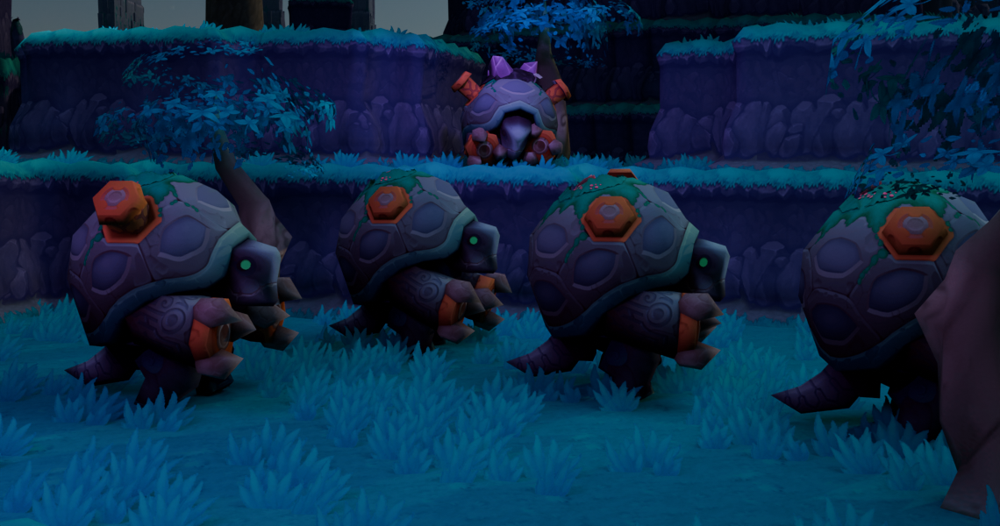

<p align="center">
  
</p>

# Tortodrone

An independent Java 25 Spiral Knights server reimplementation for the **unmodified official client**, with console and WebUI administration. Accounts use normal usernames and passwords; Steam and guest login are not supported. See [licensing and third-party content](docs/provenance.md).

**Development status:** login, native Ready Room, Haven, supported interiors and town services work within the limits described below. Crash Site → initial Rescue Camp has an earlier isolated graphical acceptance. The complete opening route to Haven is **unfinished**: Ancient Generator still needs a passing full-floor playthrough, and Crossing the Chasm is incomplete. This is not a complete replacement for the official server.

## Run a release ZIP

Install **JDK 25**, extract the complete ZIP into its own folder, open a terminal
there and run:

```sh
java -jar tortodrone.jar
```

Keep `config/`, `content/`, `webui/` and `plugins/` beside the JAR. The server
creates `data/` there; its public client key is `data/keys/public.txt`. Create a
game account with `account create Alice` in the server console, then follow
[client connection](#4-connect-the-client) using that key. WebUI is at
`http://localhost:8080/admin/`; its setup code appears in the console.

**This is a development release.** The ZIP includes seven town/interior maps;
new-knight creation additionally requires the original Crash Site and initial
Rescue Camp imports described below. Import tools require a source checkout and
separately available scene sources. WebUI image preparation does not supply
those scenes. Dependency notices are included as `THIRD-PARTY.md` in the ZIP.

## Set up from source

You need **Git** and **JDK 25** on `PATH`. The included Gradle wrapper downloads build dependencies on first use. No system Gradle, database service, Node.js or Python is needed for an ordinary build. Playing also requires your own official client, KnightLauncher and the verified opening scene sources described in step 2. Client binaries and extracted WebUI artwork are not distributed; bundled scene data has separate [rights limitations](docs/provenance.md).

The commands below run from the repository root. On Windows, replace `./gradlew` with `.\gradlew.bat`; the Java commands work in PowerShell too.

### 1. Build

```sh
git clone https://github.com/N0rule/Tortodrone.git
cd Tortodrone
java -version
./gradlew build
```

Check that Java reports version 25. The build writes one deployment to `build/`: `tortodrone.jar`, `config/`, `content/`, `webui/` and `plugins/`. It does **not** run tests. Once dependencies are cached, builds can use `--offline`.

### 2. Prepare new-knight content

A clean build includes seven Haven/interior maps. **Creating a new knight also requires original Crash Site 398 and initial Rescue Camp 217.** Without them, creation is refused with “The opening adventure is unavailable”; the server does not silently skip the tutorial.

If you already have a local deployment, check it first:

```sh
java -cp build/tortodrone.jar scripts/CheckOpeningDeployment.java build
```

If it passes, keep your existing maps. Otherwise, with the server stopped, follow [opening scene import and playtest](docs/content.md#local-crash-site-playtest). It gives the exact importer commands, required input folders and expected entrances. You need a separately installed official client and the matching scene exports you prepared yourself. Neither a Git clone nor a normal build downloads these files. Do not substitute an arbitrary revision or delete existing maps to force an import.

### 3. Start the server and create a game account

```sh
java -jar build/tortodrone.jar
```

The server runs in the terminal. Before opening its listeners, it prepares missing WebUI images from an installed client. It searches standard Steam locations and additional Steam libraries on Linux and Windows. If no client is found, the terminal asks for the installation folder (containing `code/projectx-pcode.jar` and `rsrc/`); leave it blank to skip. The client is read-only, and map scene files are not extracted. This one-time step requires the JDK, including `javac`.

For a custom installation or a service without an interactive terminal:

```sh
java -jar build/tortodrone.jar --client "/path/to/Spiral Knights"
# Or host with fallback icons and skip client discovery:
java -jar build/tortodrone.jar --skip-client-assets
```

Prepared images are cached under `build/data/client-artwork/` and restored after ordinary builds. An explicit `--client` retries setup after a skip or refreshes the pack. A missing/incompatible client does not prevent hosting; fallback icons remain available.

Default ports are **47624/TCP** for the game and **8080/HTTP** for WebUI and News. Settings are in `build/config/server.yml`; stop the process before editing them.

In the **server console**, enter:

```text
account create Alice
```

Follow the password prompts. There is no default game account. Type `help` for console commands. To end the process, enter `shutdown` and follow its confirmation prompt; `stop` only stops the game listener when WebUI is enabled.

### 4. Connect the client

Use a separately managed, unmodified Spiral Knights installation with KnightLauncher. Set these launcher properties:

```properties
game.endpoint=127.0.0.1
game.port=47624
game.publicKey=<complete contents of build/data/keys/public.txt>
```

The server generates the key on first startup. Paste the **entire public value**, including its `#` separator, rather than the filename. Keep private keys on the server. Restart the client after changing launcher settings, then use the game account created above.

For LAN or remote play, use the server's reachable address instead of `127.0.0.1` and allow the game port through the relevant firewall. `0.0.0.0` is a bind address, not a client destination.

A fresh knight enters Crash Site automatically when verified opening content is installed. A returning, completed knight enters the native Ready Room; Return to Game uses its saved destination. Use the [Crash Site acceptance procedure](docs/content.md#local-crash-site-playtest) to test combat, the Giant, exit doors, Camp arrival and reconnect. A content preflight alone does not prove gameplay.

### 5. Open the WebUI (optional)

Visit `http://localhost:8080/admin/` on the server computer, or use the address printed at startup. Create the first administrator with the one-time setup code shown in the **server console**. WebUI accounts are separate from game accounts and GM roles.

The defaults expose HTTP on local/LAN interfaces. Use a trusted network; configure the documented HTTPS proxy before exposing administration publicly. See [WebUI setup and recovery](docs/operations.md#secure-webui-setup).

## Keep your deployment

Run the JAR with these directories beside it:

```text
build/
  tortodrone.jar
  config/          server and combat settings
  content/         maps, items and town definitions
  webui/           prepared administration frontend
  plugins/         reserved; no plugin loader yet
  data/            accounts, SQLite databases, keys and logs
```

`data/` lives beside the JAR regardless of the working directory. Preserve it, your configuration and imported/customized content across updates. Back up the whole deployment while stopped. Normal builds retain imported maps; conflicting default changes are proposed under `content-updates/` for review. Do not delete databases or regenerate keys to fix a login problem. Older database schemas may require an explicit [offline upgrade](docs/content.md#upgrading).

## Supported scope

- **Accounts and world:** knight management, native Ready Room, authoritative movement/collision, seven bundled town/interior maps and locally imported opening scenes.
- **Player systems:** persistent inventory and currencies, equipment/costumes, weapon combat, heat and battle sprites. Individual item and action support varies.
- **Town and social:** supported shops/crafting, auctions, Energy Exchange, chat, friends, parties and eligible friend travel.
- **Administration:** game account management, inventory/economy tools, News and monitoring through console and WebUI.

General mission coverage, the full opening route, many special item effects, guilds, PvP and Arcade gameplay remain incomplete. Imported definitions and passing serialization tests do not establish full gameplay or visual parity. See [content and opening status](docs/content.md), the [item support inventory](docs/item-support.csv) and the [box support inventory](docs/box-support.csv).

## Work on the project

```sh
./gradlew build
./gradlew testUnit -PunitTests=SceneSimulationTest,MovementCollisionTest
```

Run tests relevant to your change. `testUnit` without a filter runs all unit programs; `testAll` runs the expensive full suite and is not the default. Tests use disposable data. See [development and verification](docs/development.md) for focused integration and isolated stock-client checks.

```text
src/main/java/    server implementation
src/test/         regression programs and fixtures
src/webui/        administration frontend
config/          default configuration
content/         maintained server definitions and bundled maps
scripts/         import, inspection and compatibility tools
docs/            operator guides and source evidence
gradle/          pinned wrapper and dependency verification
licenses/        third-party license texts
```

Original Tortodrone code and documentation use [PolyForm Noncommercial 1.0.0](LICENSE): noncommercial use and modification are permitted under its terms, and redistributed copies must retain the [N0rule/Tortodrone attribution notice](NOTICE). This is source-available, not OSI open source. Third-party dependencies and original game content retain their own rights; the project license does not license bundled scene data or extracted artwork. See [licensing and third-party content](docs/provenance.md), [dependency notices](src/main/resources/THIRD-PARTY.md) and [contribution rules](CONTRIBUTING.md). Build output, local notes, saves, keys and test captures stay outside Git.

## Documentation

| Guide | Use it for |
| --- | --- |
| [Operations](docs/operations.md) | Hosting, WebUI security, backups, updates and troubleshooting |
| [Commands](docs/commands.md) | Console and player/GM command syntax |
| [Content](docs/content.md) | Opening scene imports/playtests, map and item editing |
| [Development](docs/development.md) | Focused tests, packaging and client compatibility checks |
| [Tools](scripts/README.md) | Finding the relevant importer or diagnostic |
| [Architecture](docs/architecture.md) | Identity, storage, protocol and simulation boundaries |
